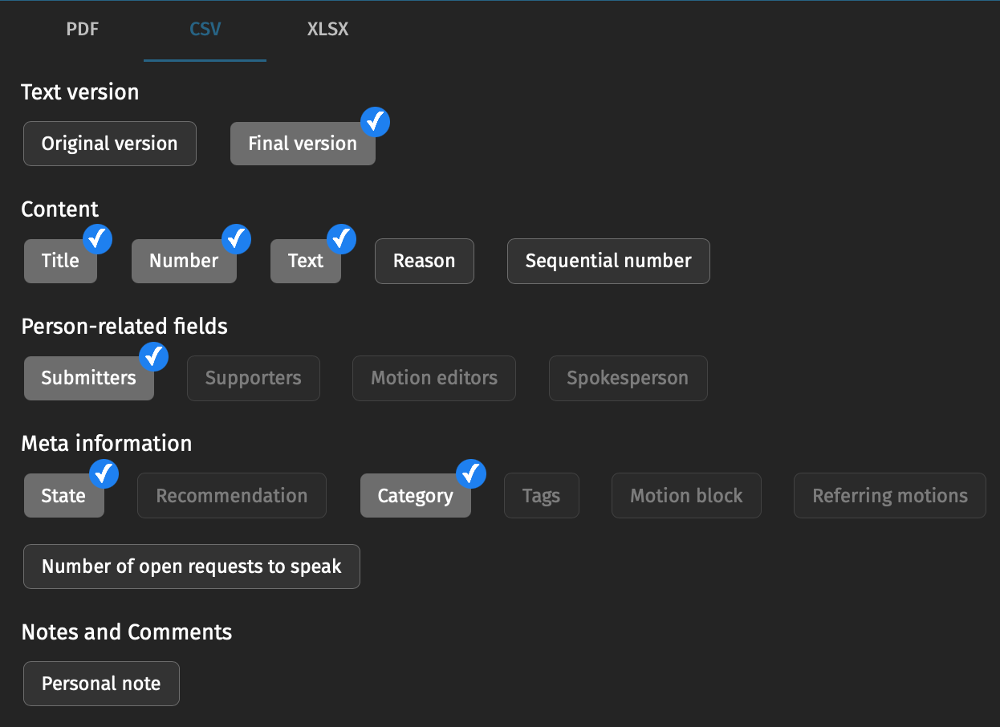
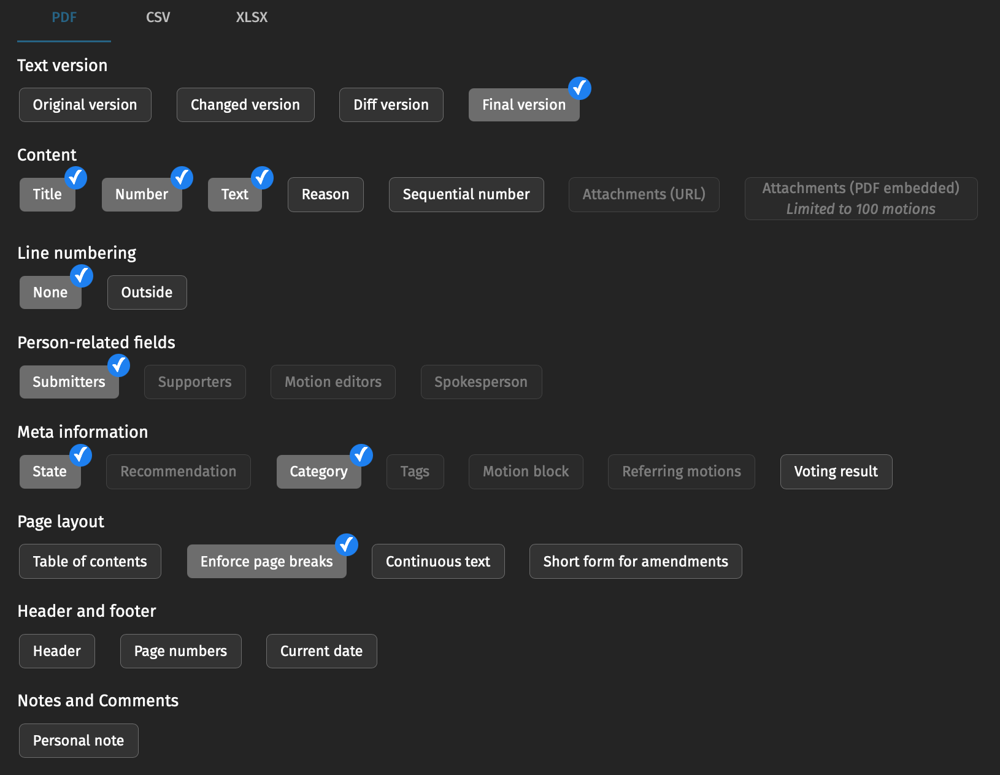

# LYMEC Policy Book

This is where the LYMEC Policy Book is kept: every resolution adopted by a LYMEC congress. After a
congress you upload the export from OpenSlides here. A few minutes later the new resolutions are in
the Policy Book PDF, and each resolution can be downloaded as a PDF and a Word file.

Everything is done in your web browser on GitHub. You do not need to install anything.

- [Where to find the Policy Book](#where-to-find-the-policy-book)
- [After a congress: add the new resolutions](#after-a-congress-add-the-new-resolutions)
- [Add a new congress](#add-a-new-congress)
- [Archiving resolutions: the status list](#archiving-resolutions-the-status-list)
- [When something goes wrong](#when-something-goes-wrong)
- [Correcting a resolution](#correcting-a-resolution)
- [What is in this repository](#what-is-in-this-repository)
- [One-time setup (repository admin)](#one-time-setup-repository-admin)


## Where to find the Policy Book

**Download page:** https://lecomte123.github.io/PolicybookExporterLYMEC/
(if the repository moves, the address is shown under *Settings → Pages*)

There you find:

- **LYMEC Policy Book**: all resolutions in force.
- **LYMEC Policy Book, archive edition**: all resolutions, including those that are no longer in force.
  Those are marked with a coloured banner ("Superseded by …" or "Archived").
- **Every resolution on its own**, as PDF and as Word file, with a search box.

> [Screenshot: the download page]

Every update is also saved as a **release**. Click *Releases* on the right side of this page. Each
release contains the two Policy Book PDFs, a zip file with all single resolutions, and a list of
what changed. Older releases stay available, so you can always find an earlier version.


## After a congress: add the new resolutions

There are six steps. Together they take about 20 minutes.

### 1. Check that the congress is in the list

Open the file `congresses.yml`. If your congress is not listed, add it first, as described in
[Add a new congress](#add-a-new-congress).

### 2. Record what the congress archived

If the congress archived or replaced resolutions, mark them in the status list first, as described in
[Archiving resolutions](#archiving-resolutions-the-status-list). If it did not, skip this step.

### 3. Export the motions from OpenSlides

In OpenSlides, open *Motions* and set two filters:

- **State**: accepted
- **Amendment**: is not an amendment

Then export the motions that are left, once as **CSV** and once as **PDF**. The PDF is used to
double-check the CSV. Choose exactly these settings:

| Setting | CSV | PDF |
|---|---|---|
| Text version | **Final version** | **Final version** |
| Content | **Title, Number, Text** | **Title, Number, Text** |
| Line numbering | (not shown) | **None** |
| Person-related fields | **Submitters** | **Submitters** |
| Meta information | **State, Category** | **State, Category** |
| Page layout | (not shown) | **Enforce page breaks** only |
| Header and footer | (not shown) | nothing |
| Notes and Comments | nothing | nothing |





### 4. Rename the files

Name both files after the congress: **year, dash, city in English**. Example for the autumn
congress 2026 in Vilnius:

```
2026-Vilnius.csv
2026-Vilnius.pdf
```

- Write the city without accents, e.g. `2027-Krakow`. For an online congress write `2027-Online`.
- Upper and lower case do not matter.
- The name must match the congress in `congresses.yml` (the line `id:`).
- Two congresses in the same city in one year: add Spring or Autumn, e.g. `2027-Brussels-Spring`.

### 5. Upload the files

1. On this page, open the folder **imports**.
2. Click **Add file** → **Upload files**.
3. Drag both files into the window.
4. Scroll down and click **Commit changes**.

> [Screenshot: "Add file → Upload files" in the imports folder]

> [Screenshot: the "Commit changes" button]

### 6. Wait, then check

Click the **Actions** tab at the top. Your upload appears there:

- yellow dot: still working (about 5 to 10 minutes)
- green tick: done
- red cross: something went wrong; an issue explains what to do (see below)

> [Screenshot: the Actions tab with a green tick]

When it is done:

- The new resolutions are on the download page and in a new release.
- Each new resolution got the next free Policy Book number in its chapter (e.g. 4.27).
- Your files moved from *imports* to a new folder in **imported**, where they are kept for the
  record. The folder is named after the date and time of the import and the congress, e.g.
  `imported/2026-10-30-12-45_2026-Vilnius/`, so several uploads for one congress stay apart.
  Uploading exactly the same file again does nothing.
- The new resolutions were added to the status list.


## Add a new congress

Do this before you upload the export of a congress, for example as soon as its dates are fixed.

1. Open the file **congresses.yml**.
2. Click the **pencil icon** (*Edit this file*).
3. Go to the end of the file and add five lines like these, with the details of your congress:

   ```yaml
   - id: 2027-Krakow
     name: LYMEC Spring Congress 2027
     city: Krakow
     date_start: 2027-04-23
     date_end: 2027-04-25
   ```

   - `id`: year, dash, city in English. This is also the name of the upload file (`2027-Krakow.csv`).
   - `name`: the name as it should appear in the Policy Book.
   - `date_start`, `date_end`: first and last day of the congress, written year-month-day.
   - Keep the layout exactly: the first line starts with a dash and a space, the other four lines
     with two spaces.
4. Click **Commit changes**.

The new resolutions get the last day of the congress as their adoption date.

**If you forget this:** the import still works. The congress is added to `congresses.yml`
automatically, with the name "LYMEC Congress 2027" and the upload day as both dates. An issue
"New congress: 2027-Krakow" reminds you to correct them. Open `congresses.yml` as above, correct
the name and the two dates of that entry and click **Commit changes**. The adoption dates of the
new resolutions are then corrected automatically.


## Archiving resolutions: the status list

The file **resolution_status_list.csv** (on the main page of this repository) lists every Policy
Book number with its status: `in force`, `archived` or `not used`. It also lists the resolutions
archived since 2020 under the numbers they had then (from the Digital Assemblies; the chapters were
renumbered after each renewal), so a number can have more than one line. GitHub shows it as a table
with a search box. The Bureau keeps it up to date. It decides which resolutions are archived:

- Every resolution marked **archived** in the list is archived: it leaves the Policy Book and moves to
  the archive edition.
- A motion may say in its text that it replaces or archives older resolutions, e.g. "This motion
  replaces: 6.03 …" or "Archiving Resolutions 6.02, 6.03". This can be at the beginning or at the end
  of the text. The automation double-checks such a sentence against the list. It only takes effect
  if the list marks that resolution as archived. If not, an issue "Please check the status list"
  asks you to confirm it, and the resolution stays in force until you do.

### Archive or replace resolutions after a congress

1. On the main page, open **resolution_status_list.csv** and click the **pencil icon** (*Edit this
   file*). Each line is one resolution. The columns are separated by commas; the first four are
   **Number, Status, Archived at, Replaced by**.
2. Find the line of the resolution: press Ctrl+F (Mac: Cmd+F) and search for the number followed by
   a comma, e.g. `6.03,`. If the number has several lines, take the one that says `in force` (the
   `archived` lines are older resolutions that had the same number). The line starts like this:

   ```
   6.03,in force,,,The future is Nuclear,2011-Utrecht
   ```

3. Change the beginning of the line:

   ```
   6.03,archived,2026-Vilnius,4.28,The future is Nuclear,2011-Utrecht
   ```

   - `archived` instead of `in force`;
   - after the next comma: the congress that archived it;
   - after the next comma: the number of the new resolution, if it was replaced. Otherwise leave it
     empty, so there are two commas in a row: `6.03,archived,2026-Vilnius,,The future…`. The new
     numbers are known after the import, so you can add this later (the issue "Please check the
     status list" tells you the number).

   Leave the rest of the line as it is.
4. Click **Commit changes**.

A few minutes later the resolutions are archived ("Archived" banner) or superseded ("Superseded by
…" banner) in the archive edition, and they are no longer in the Policy Book.

You can also download the file (**Download** button), edit it in Excel and upload it again (**Add
file → Upload files**, same name). What Excel changes when saving (semicolons instead of commas,
6.10 written as 6.1) is repaired automatically. New resolutions are added to the list after each
import, so always start from the latest version.

Change the **Number** of a line only when that resolution gets a new number: the number says which
resolution is meant. The **Title** is used to double-check that the number is right.

### Where the list comes from

The list was filled once from the Vienna 2026 Policy Book, the congress minutes and the Digital
Assemblies of 2020–2023 (lymec.eu/documents). The column **Adopted at** is the congress where a
resolution was adopted. If a resolution in force does not know its congress yet (its PDF says
"Congress not known"), write the congress there, e.g. `2015-Rotterdam`: the resolution gets it
automatically.


## When something goes wrong

If there is a problem, a message appears under the **Issues** tab. It says what is wrong and what to
do. You get an email about it if you watch this repository (see
[One-time setup](#one-time-setup-repository-admin)). There are five kinds:

**"Import failed: …"**
: Nothing was imported and the Policy Book online is unchanged. Typical reasons: the file name is
  wrong, or the CSV and the PDF do not belong together. Correct the file and upload it again
  with the same name; it replaces the old one. If the corrected file has a different name, delete
  the wrong file from the *imports* folder (open the file → **⋯** menu → **Delete file**).

**"Import incomplete: …"**
: Most motions were imported and published, but some were not. Usually several amendments in
  OpenSlides change the same line of a motion, so it is unclear what the final text is. The message
  lists the motions. Open each one in OpenSlides, create a modified final version that resolves the
  amendments, export again and upload the new file with the same name. Motions that are already in
  the Policy Book are skipped. Close the issue when everything is imported.

**"Please check the status list: …"**
: A new motion says it replaces or archives a resolution, but the status list does not mark that
  resolution as archived. If the congress decided it, update the list as described in
  [Archiving resolutions](#archiving-resolutions-the-status-list); the message says which numbers to
  enter. If not, nothing needs to be done. Close the issue afterwards.

**"New congress: …"**
: The upload belonged to a congress that was not in `congresses.yml`. See
  [If you forget this](#add-a-new-congress).

**"Publishing failed"**
: Either something in a resolution file, the status list or `congresses.yml` is not right, often
  after a correction by hand: the message names the file and what to change. Or a technical step
  of the automation failed: the message says so. Then forward the issue to whoever maintains this
  repository; there is nothing to correct in the files.

If the same problem happens again, it is added as a comment to the open issue instead of a new issue.

> [Screenshot: an "Import failed" issue]


## Correcting a resolution

Each resolution is one file in the folder **resolutions**. The file name starts with the Policy
Book number, so the folder is sorted like the Policy Book:

```
4.27_2026-Vilnius-16.md
```

- `4.27`: the Policy Book number
- `2026-Vilnius-16`: the congress and the motion number in OpenSlides. This part never changes, even
  if the resolution gets a new Policy Book number. It is shown as "Reference" in the PDF.

Resolutions from the old Policy Book are named like `1.33_PB2026-1.33.md`: their reference is their
number in the Vienna 2026 Policy Book ("PB2026"). Their texts were taken over word for word, including
the lines about adoption and former numbers. The submitting and co-signing organisations were moved
into the header, except where the list names individual members (names of people are never put in
the header); those lists stay in the text.

To change a resolution:

1. Open its file.
2. Click the **pencil icon** (*Edit this file*).
3. Make the change.
4. Click **Commit changes**.

The Policy Book is rebuilt automatically, just like after an upload.

> [Screenshot: the pencil icon on a resolution file]

The top of each file, between the two `---` lines, holds the information about the resolution.
Below it is the text of the resolution.

```yaml
---
id: 2026-Vilnius-16
number: '4.27'
title: 'Deregulate to Liberate: Making Life Affordable Again in Europe'
congress: 2026-Vilnius
adopted: 2026-10-25
category: economy
status: in_force
replaces:
- 2019-Brussels-90
superseded_by: null
amends: []
submitted_by:
- Julis
co_signers:
- Svensk Ungdom (SU)
- LHG
openslides_number: '16'
source: openslides
---
```

| Line | Meaning |
|---|---|
| `id` | Congress and motion number, as in the file name. Do not change it. |
| `number` | Policy Book number. Keep the quotes: `'4.27'`. |
| `title` | Title. Keep the quotes if there are any. |
| `congress` | The congress, as in `congresses.yml`. |
| `adopted` | Date of adoption, written `2026-10-25`. |
| `category` | The chapter. The names are listed in `categories.yml`. |
| `status` | `in_force`, `superseded` (replaced by a newer resolution), `archived` (no longer in force by decision of a congress) or `expired`. Only `in_force` resolutions are in the Policy Book; all are in the archive edition. Archive resolutions with the [status list](#archiving-resolutions-the-status-list), not here. |
| `replaces` | Resolutions that this one replaces. Filled in automatically from the status list. |
| `superseded_by` | Filled in automatically, do not edit. |
| `amends` | Resolutions that this one changes, e.g. `- '6.03'` (the number is replaced by the reference automatically). |
| `submitted_by`, `co_signers` | Organisations. Never names of people. |

Lists (`replaces`, `amends`, `submitted_by`, `co_signers`) have one entry per line, each starting
with a dash and a space. An empty list is written `[]`.

**A resolution was archived or replaced.** Use the [status list](#archiving-resolutions-the-status-list),
not the resolution file.

**Numbers are never reused.** A new resolution gets the next number after the highest one in its
chapter (e.g. 1.41), so the gaps left by archived resolutions stay. To correct a wrong number, change
`number` in the file; the file is renamed automatically. Change the number in the status list as well.

**Congress names and dates** are in the file `congresses.yml`. Edit them the same way.


## What is in this repository

| Folder or file | What it is for |
|---|---|
| `imports` | Put new OpenSlides exports here. |
| `imported` | Every uploaded export, kept for the record: one folder per import, named date-time_congress. The folder ending in `_migration` holds the Vienna 2026 Policy Book, from which the resolutions were taken over once. |
| `resolutions` | One file per resolution. |
| `resolution_status_list.csv` | The status list: every Policy Book number and whether it is in force or archived. |
| `congresses.yml` | The list of congresses since 1992. |
| `categories.yml` | The nine chapters of the Policy Book. |
| `docs` | Pictures: the LYMEC logo used in the Policy Book, and the screenshots for this guide. |
| everything else | The technical parts. Notes for developers are in `CLAUDE.md`. |


## One-time setup (repository admin)

1. *Settings → Pages → Build and deployment → Source*: choose **GitHub Actions**.
2. Do not protect the `main` branch with "Require a pull request before merging". The automation
   saves imported resolutions directly to `main`.
3. Everyone who should be told about problems or new versions: click **Watch → Custom** at the
   top of this page and tick **Issues** (problems) and **Releases** (new Policy Book versions).
